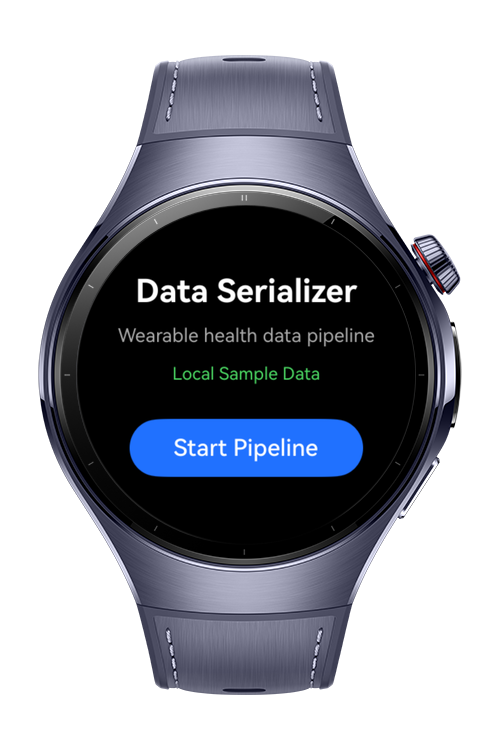
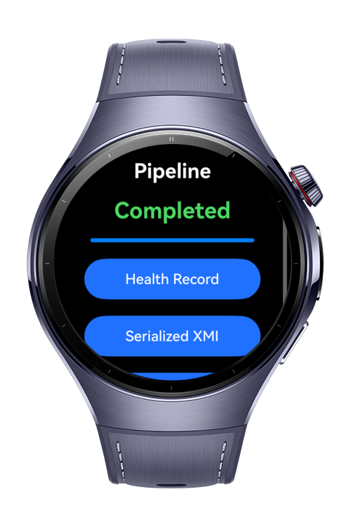
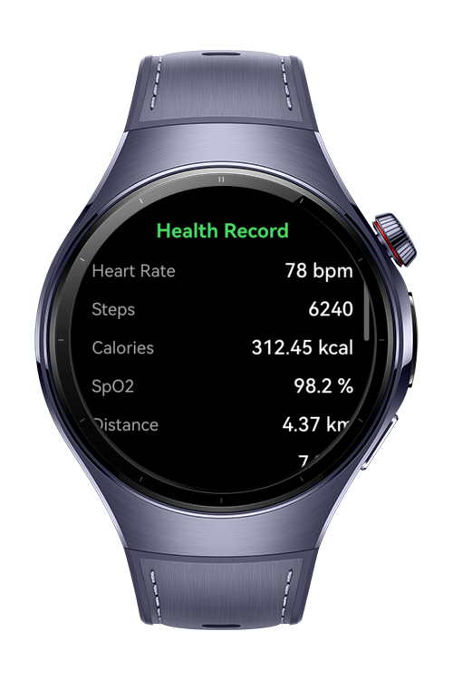
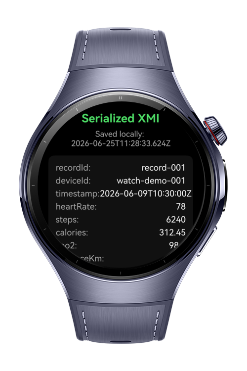

> **Note:** To access all shared projects, get information about environment setup, and view other guides, please visit [Explore-In-HMOS Index](https://github.com/Explore-In-HMOS/hmos-index).

# How To Build Data Serializer

This app demonstrates a small health data serialization pipeline on a wearable
watch screen. All incoming health data is simulated from local mock XMI/XML
strings. There is no sensor, Bluetooth, Health Kit, Wear Engine, backend, or
network.

# Preview

<div>
  
  
  
  
</div>

# Use Cases

- Parse and serialize simulated XML/XMI health records.
- Process large input safely in stream chunks.
- Pack and unpack health metrics with a compact binary buffer.
- Use decimal-safe arithmetic for precision-sensitive health metrics.
- Save the processed result locally and present it on a watch.

# Tech Stack

- **Languages**: ArkTS, ArkUI
- **Frameworks**: HarmonyOS SDK 5.0.0(12)
- **Tools**: DevEco Studio 5.0
- **Libraries**:
    - `@kit.ArkTS`
    - `@kit.ArkData`
    - `@kit.AbilityKit`

# Directory Structure

```
entry/src/main/ets/
├───entryability
│       EntryAbility.ets
├───mock
│       MockBinaryPackets.ets
│       MockHealthRecords.ets
├───model
│       HealthMetricPacket.ets
│       HealthRecord.ets
│       PipelineState.ets
├───pages
│       BufferDemoPage.ets
│       HealthRecordPage.ets
│       Index.ets
│       PipelineStatusPage.ets
│       SerializedOutputPage.ets
├───service
│       ConvertmlAdapter.ets
│       DecimalCalculator.ets
│       FastBufferAdapter.ets
│       HealthDataPipeline.ets
│       LocalStorageService.ets
│       StreamProcessor.ets
│       XmiSerializer.ets
│       XmlPullParserAdapter.ets
└───utils
        Logger.ets
```

# Constraints and Restrictions

## Supported Device

* Huawei Watch 5

# License

**How To Build Data Serializer** is distributed under the terms of the MIT License
See the [LICENSE](./LICENSE) for more information.